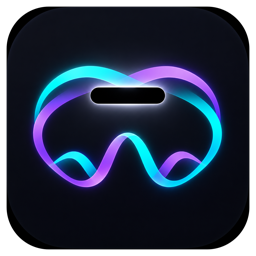

<p align="center">
  
</p>

<h1 align="center">Notchloom</h1>

<p align="center">
  <strong>Your notch, woven in.</strong><br>
  Music, useful controls, and system feedback in the space around your Mac's notch.
</p>

<p align="center">
  <a href="https://github.com/andomatthew1234/notchloom/actions/workflows/cicd.yml"></a>
  &nbsp;·&nbsp;
  <a href="LICENSE">GPL-3.0 license</a>
  &nbsp;·&nbsp;
  <a href="https://github.com/TheBoredTeam/boring.notch">Based on Boring Notch</a>
</p>

---

Notchloom is a macOS notch utility built from [Boring Notch](https://github.com/TheBoredTeam/boring.notch). Hover over the notch to open a small space for music and quick tools. When it is closed, playback and system events can still appear at the top of your display. The fork adds its own name, cyan and violet icon, matching settings, and a branded drag-to-Applications installer.

## What it does

- **Music at a glance.** See artwork and playback status, use configurable controls, and show lyrics when available.
- **A custom system HUD.** Show volume, brightness, and keyboard backlight changes in the notch, including a compact inline view when closed.
- **Notifications from the notch.** The notch itself expands into one continuous black surface for visible macOS banners. Compact text, staged spring motion, hover pausing, and a queue keep alerts readable. Clock alerts stay visible longer; original macOS actions remain available.
- **Focus time.** Start a 5, 15, 25, or 50 minute session, pause it, and see a quiet completion card. The timer survives app restarts.
- **Quick apps.** Launch up to four favorite Mac apps from the notch and arrange them in Settings.
- **Sound output.** See the current speaker or headphones and switch outputs from the notch.
- **Quick tools.** Open a camera mirror, view calendar events and reminders, or use the file shelf and Quick Share when you enable them.
- **Fits your display.** Adjust notch sizing, hover behavior, gestures, and which displays show Notchloom.
- **Your own look.** The settings window uses the Notchloom logo and a dark cyan and violet theme.

The main controls remain customizable. Notchloom's starting choices reflect this fork's preferred setup; they do not lock anyone into it.

## Install status

**There is no public signed and notarized Notchloom download yet.** The themed DMG has been built and tested locally, but the app currently uses an Apple Development signature. The original project's download and Homebrew links install **Boring Notch**, not this fork.

You can [build Notchloom from source](#build-from-source). A public installer is pending distribution signing and notarization.

## Defaults on a fresh install

| Area | Starting choice |
| --- | --- |
| General | Launch at login; show on all displays; hide the menu bar icon |
| Interaction | Open immediately on hover; use an extended hover area and gestures |
| Music | Show lyrics and live activity; use Shuffle, Previous, Play/Pause, Next, and Favorite controls |
| Appearance | Enable the camera mirror and album-art slider colors; leave Calendar and the file shelf off |
| HUD | Replace the system HUD after Accessibility is granted; use the inline style with glow, accent tint, and percentages |
| Notifications | Mirror visible app banners and Clock alerts from the notch when Accessibility is available |
| Tools | Show Finder, Safari, Music, and Calculator as starter quick apps; keep the focus timer idle |

Existing preferences stay in place when upgrading. Permissions, completed onboarding, and device-specific display IDs are never copied from the maintainer's Mac. Camera access is needed for the mirror; Accessibility access is needed for HUD replacement, media-key interception, and visible notification banners. Notchloom does not read notification history or bypass hidden previews.

## Build from source

You need macOS 15.6 or later and Xcode 26 or later.

```bash
git clone https://github.com/andomatthew1234/notchloom.git
cd notchloom
open boringNotch.xcodeproj
```

Select the `boringNotch` scheme, choose your Apple Development signing team, and build. Xcode produces **Notchloom.app**. The internal project and bundle identifiers retain their upstream names so existing Boring Notch preferences can migrate.

### Build the themed installer

With a signed Release app and [`uv`](https://docs.astral.sh/uv/) installed, run:

```bash
installer/build_dmg.sh /path/to/Notchloom.app
```

The script uses a pinned `dmgbuild` version and writes `dist/Notchloom-<version>.dmg`. The [installer artwork and layout](installer/) are included in this repository. The local DMG is not a substitute for a Developer ID signed and notarized public release.

## Updates, credits, and license

The [Notchloom appcast](appcast.xml) is empty until the first public binary release. Update checks point to this fork, so Notchloom will not install an upstream Boring Notch build.

Notchloom is based on [Boring Notch by TheBoredTeam](https://github.com/TheBoredTeam/boring.notch). The original README is preserved in [docs/UPSTREAM_README.md](docs/UPSTREAM_README.md). This fork keeps the project's [GNU GPLv3 license](LICENSE). The Notchloom icon was generated for this fork and prepared as a macOS app icon.

Notification presentation and verification are described in [the design notes](docs/notification-design.md).
