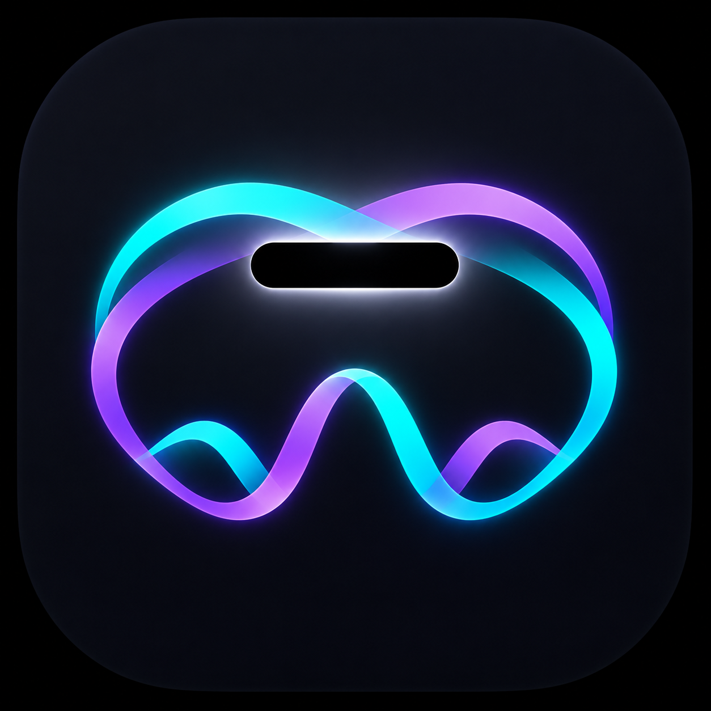

# Notchloom



Notchloom is a personal fork of [Boring Notch](https://github.com/TheBoredTeam/boring.notch), a macOS notch utility. It keeps the upstream features and starts new users with the settings used for this fork. Existing users' saved preferences are respected.

## Status

The source builds locally, but a public signed and notarized binary has not been released yet. The upstream project's download and Homebrew links install **Boring Notch**, not Notchloom. See the [upstream README](docs/UPSTREAM_README.md) for the original project documentation.
The upstream release and nightly publishing workflows were removed because their signing and download links belong to the original project.

## Build from source

Requirements: macOS 15.6 or later and Xcode 26 or later.

```bash
git clone https://github.com/andomatthew1234/notchloom.git
cd notchloom
open boringNotch.xcodeproj
```

Select the `boringNotch` scheme, choose your own Apple Development signing team, and build. The resulting app is named **Notchloom**. On a fresh install, macOS may ask for Camera and Accessibility access before the mirror and HUD features work.

## Defaults for new users

| Area | Default |
| --- | --- |
| General | Launch at login on; menu bar icon off; show on all displays and on the lock screen |
| Notch | Open on hover immediately; extended hover area; gestures and close gesture on; high gesture sensitivity |
| Sizing | Match real notch height on notch displays; match menu bar height on other displays |
| Appearance | Mirror on; calendar and idle face off; slider color matches album art |
| Music | Now Playing when supported; music live activity and lyrics on; Shuffle, Previous, Play/Pause, Next, Favorite controls; hide in full screen for the media app only |
| Battery and shelf | Battery indicator off; shelf off; AirDrop selected for Quick Share |
| HUD | Replacement enabled once Accessibility is granted; Inline style; percentages in open and closed notch; accent tint and glow on; gradient off |
| Updates | Automatic checks on; automatic installation off; feed points to this fork |

Screen identifiers, completed onboarding, permissions, and other device-specific state are not copied from the maintainer's Mac. The default login item is registered only on a fresh installation; later user choices are preserved. Users can change all settings in the app.

The fork's [appcast](appcast.xml) is empty until the first signed binary release. The update signing private key is kept outside the repository.

## Installer

The branded drag-to-Applications disk image is built from a signed Release app:

```bash
installer/build_dmg.sh /path/to/Notchloom.app
```

The script uses `uvx` to run a pinned `dmgbuild` version and writes the versioned image to `dist/`. Its Finder artwork and layout live in [`installer/`](installer/). The disk image made for local testing uses an Apple Development signature; a public Mac download still needs a Developer ID signature and Apple notarization.

## Credits and license

Based on Boring Notch by [TheBoredTeam](https://github.com/TheBoredTeam/boring.notch). Notchloom retains the project's [GNU GPLv3 license](LICENSE). The Notchloom icon was generated for this fork and prepared for the macOS app icon asset catalog.
